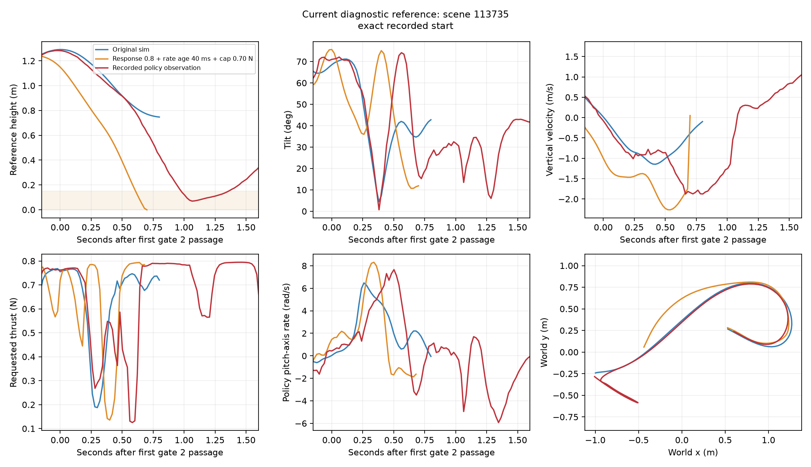

**Gate 3 altitude loss: current reference and English handoff**

Start here. The current diagnostic reference is **`actuator_delay`**: motor response multiplier **0.8**, policy angular-velocity input delayed **40 ms**, and achievable total motor capacity **0.70 N**. The frozen policy, controller gains, drag, mass, inertia and all other parameters remain nominal. This supersedes the earlier gain-changing `paired` candidate as the main reproduction case.

This is a reproducible failure hypothesis, **not an identification of the real drone's parameters**. The reference reproduces a gate-2-to-gate-3 ground-height failure and sensitivity to nearby starts. It does not match both complete hardware flights.

**Exactly what changes**

| Setting | Current reference | Interpretation |
|---|---:|---|
| `rotor_rate` | 0.8 | Multiply motor spin-up/spin-down dynamics coefficients by 0.8; motors follow target RPM more slowly |
| `omega_delay` | 2 policy steps | A fixed 40 ms age for the angular-velocity feature at the checked-in 50 Hz policy rate |
| `thrust_cap` | 0.70 N | Constrain achievable per-motor force/RPM; the policy may still request higher total thrust |

Position, orientation and translational velocity stay current. There is no extra command delay, no additional deployment DiffFilter and no added measurement noise in this reference. Interference is present from takeoff, with no gate-triggered intervention. `kw` and `kR` remain unchanged; the old `damping` field scales a controller feedback gain, not passive airframe damping.

The simulator already models gradual motor acceleration/deceleration. The multiplier 0.8 makes that existing response slower. A model-derived local linearization near hover gives approximately 57/62 ms spin-up/down time constants at 1.0, 71/78 ms at 0.8, and 114/124 ms at 0.5. These are model estimates, not measured hardware delays.

**What the experiments show**

At the exact 12:37 hardware-matched start, the reference crosses gates 1/2 at 0.98/1.74 s and reaches model ground height at 2.44 s. The exact-start low point is about 0.62 m away horizontally from the recorded low point and 0.36 s earlier relative to gate 2. It lies outside the predefined near-gate-3 spatial box, despite being between gates 2 and 3 in task progress. Ground impact dynamics and propeller clearance are not calibrated.

With the same parameters and 20 small start perturbations per scene:

| Start | Reach gate 2 | Below 15 cm near gate 3 | Below 1 cm near gate 3 | Pass gate 3 | Finish all five crossings |
|---|---:|---:|---:|---:|---:|
| 12:37 | 20/20 | 10/20 | 6/20 | 9/20 | 8/20 |
| 12:52 | 10/20 | 0/20 | 0/20 | 10/20 | 4/20 |

Categories overlap: a low pass can recover and subsequently cross gate 3. Both scenes and these perturbations have been used during the investigation; this is not an independent hardware validation set or a hardware crash-probability estimate. Matching nominal controls pass all crossings in all 40 perturbations, with no below-15-cm episode.

For the exact 12:37 start:

| Withdraw one factor | Minimum height between gates 2/3 | Outcome |
|---|---:|---|
| All three reference factors | Approximately ground | Ends before gate 3 |
| Remove angular-velocity delay | 0.756 m | Finishes |
| Restore capacity to 0.80 N | 0.751 m | Finishes |
| Restore motor response to 1.0 | Segment not reached | Fails before gate 2 |

The loop is nonlinear: removing a disturbance can also change earlier behaviour. These rows do not isolate additive causal contributions.

The selected nearby example, **seed 16**, has a low point about 0.20 m away and 0.044 s different in relative timing. Its pitch-rate peak remains about 0.14 s early. It was selected after inspection and is included as an illustration, not a representative or independent validation case.



Also inspect [the selected nearby example](results/reference/plots/reference_113735_seed16.png) and [the 12:52 counterexample](results/reference/plots/reference_115247_seed0.png). These show remaining differences as well as the reproduced altitude loss.

**What the other follow-ups rule out within their tested ranges**

- With response 0.8, 20–30 ms input low-pass constants or pure input ages, and reduced motor capacity, 406 checks including controls and small start perturbations did not reach below 15 cm between gates 2/3. The lowest default-filter case reaches about 0.50 m and then collides with a gate.
- Pure 40/50/100 ms input-age sweeps distinguish delaying angular velocity alone from delaying all kinematics. The positive exact-start case is angular velocity alone at 40 ms and capacity 0.70 N. Exact 50 ms checks and 100 ms cases do not reproduce the same low pass. Delaying all kinematics by 100 ms prevents reaching gate 2 in those cases.
- The actual locked deployment DiffFilter derives velocities from pose samples and uses different field time constants: position 0.1 ms, velocity 7 ms, acceleration 90 ms, orientation 5 ms and angular velocity 70 ms. Separate tests of that filter plus 40–100 ms added measurement transport age mostly fail earlier, without the same ground-height segment. Assumed mocap rates and transport ages are sensitivity conditions, not measured flight settings.

See [the full current-reference analysis](docs/actuator_delay_reference.md), [the milder-response/default-filter follow-up](docs/response80_followup.md), and [the earlier gain-changing investigation](docs/historical_gain_sweep.md). The input-height error, sorting sensitivity and earlier hardware observations remain documented in the historical report; they are not established as the unique cause of all gate-3 failures.

**Run the current reference**

Use the existing project Python environment. The diagnostic assumes the checked-in 50 Hz policy and 500 Hz physics/attitude loops. Recorded versions: Crazyflow 0.4.0, JAX/JAXlib 0.11.0, NumPy 2.5.2, SciPy 1.18.0, MuJoCo 3.10.0 and Flax 0.12.8. The wrapper is an offline Python diagnostic, not a drop-in JIT/vectorized training wrapper.

```bash
# The default preset is actuator_delay. No training or deployment changes occur.
python -B debug_real_analysis/scripts/reproduce.py --scene 113735
python -B debug_real_analysis/scripts/reproduce.py --preset actuator_delay --scene 115247
python -B debug_real_analysis/scripts/reproduce.py --preset baseline --scene 113735

# The explicitly selected nearby example; perturbation seeds match the archived protocol.
python -B debug_real_analysis/scripts/reproduce.py --scene 113735 --seed 16

# Regenerate 50 reference/withdrawal episodes. Existing complete cases are resumable.
python -B debug_real_analysis/scripts/validate_reference.py

# Plot bundled data against hardware inputs without running new simulations.
python -B debug_real_analysis/scripts/plot_reference.py --scene 113735
python -B debug_real_analysis/scripts/plot_reference.py --scene 113735 --seed 16
python -B debug_real_analysis/scripts/plot_reference.py --scene 115247
```

Scripts resolve repository inputs from their locations and also work from another working directory. New outputs and caches go to ignored `debug_real_analysis/generated/`; set `DRONE_DEBUG_OUTPUT_DIR` to use another directory. Bundled results and the branch's existing hardware `runs/` are read-only inputs.

Additional follow-up generators are in `scripts/`: `actuator_jitter.py`, `response80_input_filter.py`, `response80_fixed_delay.py`, `response80_jitter.py`, `response80_long_delay.py`, `response80_delay50_physics.py`, `default_deploy_filter.py` and `default_deploy_long_age.py`. Deployment-filter scripts lazily download the exact lockfile wheel into the ignored output directory, verify its SHA-256 and import it without installation. For offline use, set `DRONE_ESTIMATOR_WHEEL` to the already downloaded `drone_estimators-0.1.0-py3-none-any.whl` file.

**Included data and provenance**

- `results/reference/config.json`: the full reference configuration, unchanged defaults, versions, model hashes and limitations.
- `results/reference/metrics.json`: **92 archived records and full NPZ trajectories**: 42 exact/perturbed reference cases, eight withdrawals, and 42 matching nominal controls from the earlier validation.
- `results/reference/summary.json`: reference/control perturbation outcomes.
- `results/followups/metrics.json`: **750 newer follow-up records**, with phase labels and explicit trajectory-inclusion flags. These comprise 84 earlier actuator-only checks, 406 mild-response checks and 260 long-delay checks; repeated checks are included.
- `results/followups/inventory.json`: source phase counts and hashes. Non-reference bulk trajectories remain local and can be regenerated; their metrics are preserved.
- [VERIFICATION.md](VERIFICATION.md): package and reproduction checks. `SHA256SUMS` covers the tracked report, scripts and results.

Frozen deployed-model SHA-256 values:

```text
config.json     12e4613f1772d4407f441736e7e77f0296cb75c20a1b93ea99117e5fbf941c9e
policy.msgpack  9b5116f127abc0a4fa2c492c06385ce843883b18e64a0c01dd241348b2cc9394
```

The analysis source baseline is `d27923be237e18a4363bf1eea77f90e955d4ad09`; the earlier English handoff is `d6512f4406d959f31a35862381b41430bd7e912e`. Production code, model weights and competition configuration are unchanged. The current reference prioritizes three measurable interfaces for further investigation—policy angular-rate age, motor response and available motor authority—while actual hardware values still require measurement.
